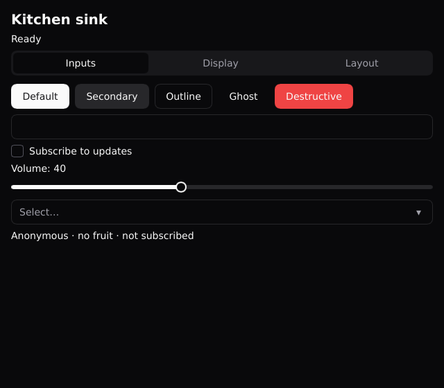

# RageKit

Desktop apps in PHP, compiled to native code and drawn on the GPU — no browser engine.

You write screens as PHP classes and their layout as small `.rk` templates. RageKit compiles the
PHP to machine code with [TypePHP](https://github.com/swoole/typephp), turns the templates into a
[Slint](https://slint.dev) UI, and produces an ordinary executable.

```sh
composer create-project ragekit/starter myapp   # a new app, ready to build (see Get started)
```



> **Status: experimental (0.x).** Linux is where it's built and tested. Windows works but is
> tested less. macOS isn't supported yet: it hasn't been built or tested there. APIs will change.
>
> **For open-source apps only.** Apps built with RageKit are GPLv3 (see [License](#license)).
>
> **This project is vibe-coded.** It was designed by its author and written largely with an AI
> coding assistant (Claude). Every feature has automated tests (unit tests plus end-to-end runs of
> the demo apps), but it is young and not battle-tested. Read the code before you trust it with
> anything important.

## What it looks like

```php
// src/CounterScreen.php — state is public properties, handlers are methods
final class CounterScreen extends \RageKit\Screen
{
    public int $count = 0;
    public string $name = '';

    public static function template(): string
    {
        return 'templates/CounterScreen.rk';
    }

    public function greeting(): string
    {
        return $this->name === '' ? 'Type your name above' : "Hello, " . $this->name . '!';
    }

    public function increment(): void
    {
        $this->count++;
    }
}
```

```xml
<!-- templates/CounterScreen.rk -->
<VStack>
    <Label text="Count: {count}" />
    <Button text="+" onClick="increment" />
    <Entry value="{name}" />
    <Label text="{greeting}" />
</VStack>
```

```php
// main.php
function main(): void
{
    $app = new \RageKit\App();
    $app->open(new CounterScreen(), title: 'Counter', width: 360, height: 420);
    $app->run();
}
```

After every event the window shows the screen's new state; there is no manual re-rendering.

## What you get

- **Compiled PHP.** TypePHP compiles your PHP (a large subset of the language) to C++ and then to
  machine code.
- **A drawn UI.** Slint renders the widgets itself, so you get custom looks (rounded cards,
  shadows, themes) on every platform. They are not the OS's own widgets.
- **Kits.** The same template builds with `shadcn` (dark, minimal) or `material` (Material 3), or
  with a kit you write.
- **Hot reload.** `ragekit dev` reloads templates in place and restarts only your PHP when it
  changes, keeping the screen's state (Linux only for now).
- **Native modules.** Device and OS features as runtime-loaded libraries with a PHP API, starting
  with audio and HTTP. An app still runs when a module's library is missing.
- **Your own title bar.** A layout frames screens in a frameless window with an app-drawn bar that
  moves, resizes, maximises and closes the window (Windows and Linux).
- **Nano builds.** One small executable with a stripped-down PHP runtime compiled in.

## What's inside the executable

RageKit's claim is "compiled, GPU-rendered, no Chromium" — and it tries not to claim more:

- A **normal build** contains your compiled code plus PHP's runtime (linked statically on Linux,
  shipped as DLLs on Windows).
- A **Nano build** (`ragekit: { nano: true }`) compiles a stripped-down PHP runtime (php-nano) into
  the executable: no PHP libraries next to it, no bytecode interpreter, no `eval`/`include`, no
  PHP networking (use the `http` module instead). It is still PHP's engine, just smaller.
- Slint's library (`libslint_cpp`, about 40 MB on Linux, 27 MB on Windows) and RageKit's small
  bridge library ship next to the executable.

Measured on the demo apps with Slint's software renderer: about 27 MB of private memory on Linux
for a normal build and 20 MB for Nano. A Nano executable is about 3 MB; a normal one is 51 MB with
the private PHP linked in, or 0.3 MB plus PHP's library (6 MB) when it links your system's PHP. A calculator app on
Windows used 13 MB normal and 8 MB Nano. GPU renderers draw shadows but use far more memory,
mostly driver overhead.

## Limits

- TypePHP compiles a **subset of PHP**: frameworks like Laravel won't compile. See TypePHP's
  documentation for what's unsupported.
- Your PHP runs on the **UI thread**: long work freezes the window. Only native modules can do
  work on other threads so far.
- No PHP networking functions in Nano builds; the `http` module works there.
- Accessibility and input methods depend on Slint, not the OS's widgets.

## Get started

Start a new app from the starter project:

```sh
composer create-project ragekit/starter myapp
cd myapp
composer start                      # build, then run the app
```

`create-project` also runs `ragekit setup`, which installs TypePHP and Slint (shared per user, so
only the first app downloads them) and checks your system. You need PHP 8.4+, Composer, git and a
C++ compiler. On Windows that's Visual Studio 2022 Build Tools; when they're missing,
`create-project` offers to install them. You also need 7-Zip. The full list and a tour of the app
are in [Getting started](docs/getting-started.md).

### Trying the demos

To run the demo apps instead, clone this repository:

```sh
git clone https://github.com/hunwalk/ragekit.git && cd ragekit
./setup.sh                          # Composer, then TypePHP + Slint (shared per user), then a check
cd demo/kitchen-sink && ../../bin/ragekit run
```

On Windows, run `setup.ps1` instead of `setup.sh`.

## Documentation

- [Getting started](docs/getting-started.md) — requirements, a first app, building and running
- [The toolchain](docs/toolchain.md) — TypePHP, Slint, `ragekit setup` / `doctor`, normal vs Nano
- [Templates](docs/templates.md) — `.rk` syntax, elements, components
- [Kits](docs/kits.md) — choosing and writing UI kits
- [Native modules](docs/modules.md) — using and writing modules (audio, http)
- [Dev mode](docs/dev-mode.md) — `ragekit dev` and hot reload
- [Architecture](ARCHITECTURE.md) — how the repository is laid out
- [Changelog](CHANGELOG.md) — what changed in each version, and what counts as breaking

## Demos

| Demo | Shows |
|---|---|
| `demo/calculator` | logic in plain PHP, a keypad from a constant with `each` |
| `demo/counter-slint` | state, two-way input, a child component, a second window |
| `demo/kitchen-sink` | every core element, in three tabs (`--kit=material` to compare kits) |
| `demo/kit-demo` | an app's own kit (`kits/icons`) with SVG icons embedded at build time |
| `demo/player` | the audio module: play, pause, progress, volume |
| `demo/titlebar` | a layout: frameless window, own title bar with a search box and window buttons |
| `demo/fetch` | the http module: a GitHub API lookup and a download with progress (needs the internet) |

Run one with `../../bin/ragekit run` from its folder, or `../../bin/ragekit dev` for hot reload.

## License

RageKit is licensed under the [GNU General Public License v3](LICENSE). Its runtime is compiled
into every app it builds, so apps you distribute are GPLv3 too. It builds on TypePHP, Slint, PHP
and others; see [third-party notices](THIRD_PARTY_NOTICES.md) for their licenses and what they
mean for your app.

**Closed-source apps aren't possible today.** Two things stand in the way:

- RageKit's own runtime is GPLv3. This may change later (for example with an exception for the
  runtime); it isn't decided.
- Slint, which draws the UI, is GPLv3 for RageKit. Slint also offers a royalty-free license that
  allows closed-source desktop apps, but that license doesn't allow distributing a framework that
  exposes Slint's API, which is what RageKit does. Whether an app built with RageKit could still
  use Slint's royalty-free license for itself is an open question we haven't asked Slint yet.

RageKit is an independent project, not affiliated with the TypePHP or Slint projects.
